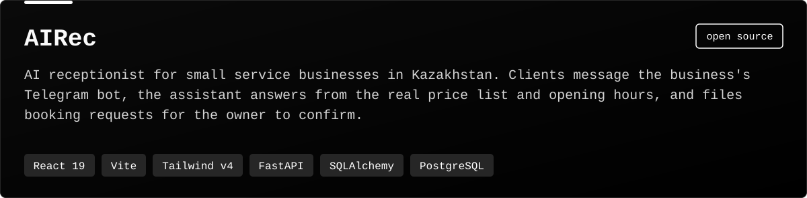
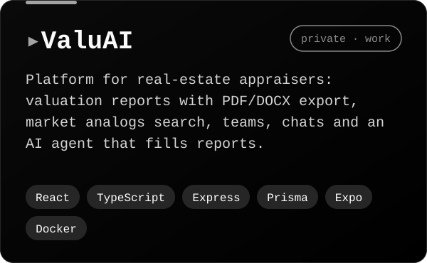
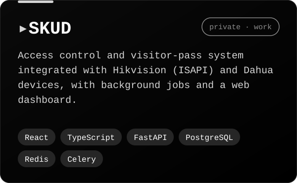

<div align="center">



<br/>

<a href="https://linkedin.com/in/nurk3ldi"></a>&nbsp;
<a href="https://instagram.com/nurk3ldi"></a>&nbsp;
<a href="https://nurk3ldi.netlify.app/"></a>


</div>

## About

```text
whoami:   nurk3ldi
role:     full-stack developer
based:    Astana, Kazakhstan
now:
  - building AIRec, an AI receptionist for small businesses
  - shipping web + mobile platforms for clients at work
studying: software engineering
setup:    Arch Linux + Hyprland, Zed, Claude Code
```

I like turning messy real-world processes into simple products: a clear UI on top,
a reliable API underneath, and AI where it actually saves someone time.

## Tech stack

<div align="center">



</div>

## Projects

<div align="center">

<a href="https://github.com/nurk3ldi/AIRec"></a>




</div>

## Activity

<div align="center">


<br/><br/>

<picture>
  <source media="(prefers-color-scheme: dark)" srcset="https://raw.githubusercontent.com/nurk3ldi/nurk3ldi/output/snake-dark.svg" />
  <source media="(prefers-color-scheme: light)" srcset="https://raw.githubusercontent.com/nurk3ldi/nurk3ldi/output/snake-light.svg" />
  
</picture>

<sub>stats and snake are rebuilt every 12 hours by <a href=".github/workflows/profile.yml">a GitHub Action</a></sub>

</div>
