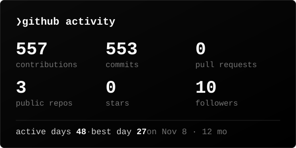

<!-- view counter: invisible, it only counts visits; the number is shown in the header -->

## About

## Tech stack

## Projects

## Activity

  

<picture>
  <source media="(prefers-color-scheme: dark)" srcset="https://raw.githubusercontent.com/nurk3ldi/nurk3ldi/output/snake-dark.svg" />
  <source media="(prefers-color-scheme: light)" srcset="https://raw.githubusercontent.com/nurk3ldi/nurk3ldi/output/snake-light.svg" />
  
</picture>

stats and snake are rebuilt every 12 hours by <a href=".github/workflows/profile.yml">a GitHub Action</a>

