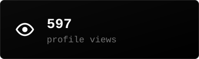
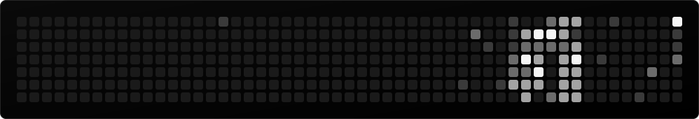

<!-- every image has a `-mobile` twin (bigger text, stacked layout) that <picture> swaps in on screens up to 700px wide -->

<picture><source media="(max-width: 700px)" srcset="https://raw.githubusercontent.com/nurk3ldi/nurk3ldi/main/assets/header-mobile.svg?v=7"></picture>

<a href="./NurkeldiCV-EN.pdf"><picture><source media="(max-width: 700px)" srcset="https://raw.githubusercontent.com/nurk3ldi/nurk3ldi/main/assets/card-cv-mobile.svg?v=7"></picture></a>
<picture><source media="(max-width: 700px)" srcset="https://raw.githubusercontent.com/nurk3ldi/nurk3ldi/output/card-views-mobile.svg"></picture>
<a href="https://linkedin.com/in/nurk3ldi"><picture><source media="(max-width: 700px)" srcset="https://raw.githubusercontent.com/nurk3ldi/nurk3ldi/main/assets/card-linkedin-mobile.svg?v=7"></picture></a>

<!-- view counter: invisible, it only counts visits; the number is shown in the views card -->

## About

<picture><source media="(max-width: 700px)" srcset="https://raw.githubusercontent.com/nurk3ldi/nurk3ldi/main/assets/about-mobile.svg?v=7"></picture>

## Tech stack

<picture><source media="(max-width: 700px)" srcset="https://raw.githubusercontent.com/nurk3ldi/nurk3ldi/main/assets/stack-mobile.svg?v=7"></picture>

## Projects

<a href="https://github.com/nurk3ldi/AIRec"><picture><source media="(max-width: 700px)" srcset="https://raw.githubusercontent.com/nurk3ldi/nurk3ldi/main/assets/project-airec-mobile.svg?v=7"></picture></a>

<picture><source media="(max-width: 700px)" srcset="https://raw.githubusercontent.com/nurk3ldi/nurk3ldi/main/assets/projects-work-mobile.svg?v=7"></picture>

## Activity

<picture><source media="(max-width: 700px)" srcset="https://raw.githubusercontent.com/nurk3ldi/nurk3ldi/output/activity-mobile.svg"></picture>

stats and the Game of Life are rebuilt every 12 hours by <a href=".github/workflows/profile.yml">a GitHub Action</a>

